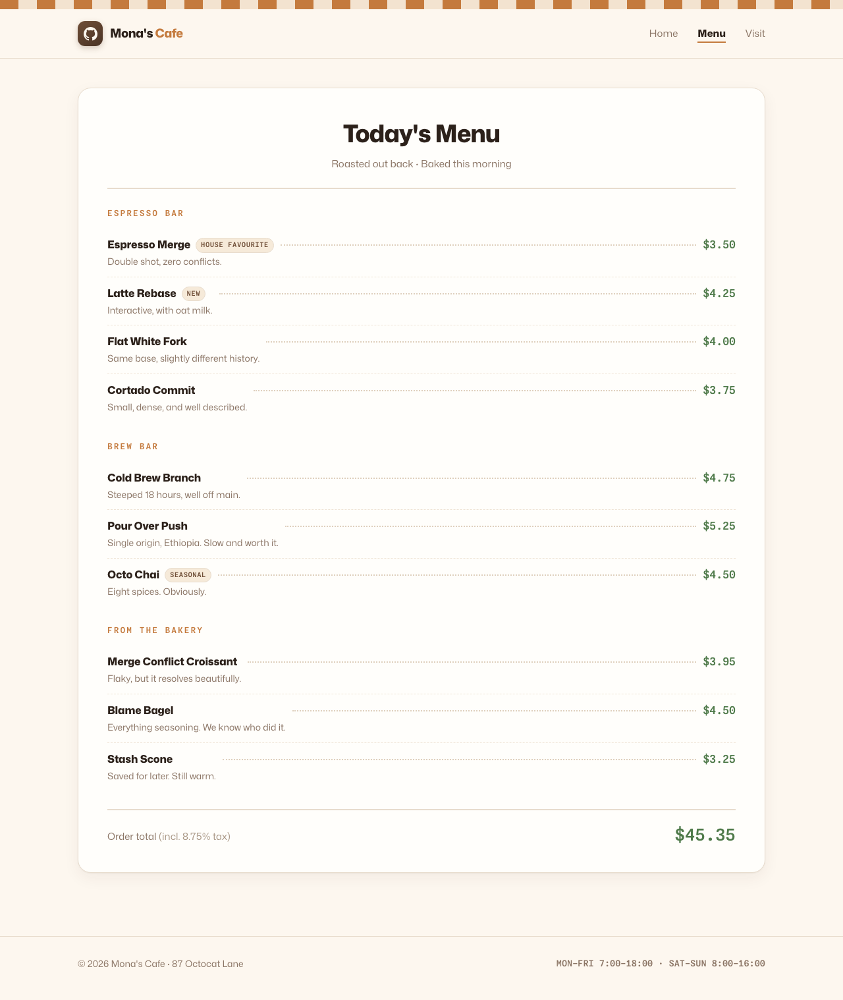

<p align="center">
  
</p>

**Section 1 · Tutorial 1 · 5 min · 3 steps**

Use `--attach` to add a screenshot to an issue, straight from the terminal.

> **Note**
>
> Mona's café tests its menu site with [Playwright](https://playwright.dev),
> a browser automation tool. In an automated workflow, Playwright opens the
> site in a headless browser on every pull request, clicks through each page,
> checks what it sees and saves screenshots when something looks wrong. On its
> last run it caught every price on the menu showing `$NaN` and saved
> [`menu-prices.png`](menu-prices.png).
>
> You'll file that bug with the screenshot attached, without leaving the
> terminal. A workflow can run the same `gh issue create --attach` command to
> report failures on its own.

## 1. Go to this folder

```bash
cd "$(git rev-parse --show-toplevel)"
cd 01-github-latest-features/attach-images-to-an-issue
```

## 2. Create an issue with the screenshot

The text after `#` is the image's alt text.

```bash
url=$(gh issue create \
  --title "Menu prices show \$NaN" \
  --body "Playwright caught this:" \
  --attach 'menu-prices.png#Menu board showing $NaN') &&
printf '\n\033[1mYour issue: %s\033[0m\n\n' "$url"
```

## 3. Open your issue

Open the bold **Your issue** link the terminal prints. The screenshot is in
the issue.

> **Tip**
>
> `--attach` also works with `gh issue comment` and `gh pr create`.

## What you'll attach

<p align="center">
  
</p>

<p align="center"><a href="menu-prices.png"><b>menu-prices.png</b></a> · every price on the menu shows <code>$NaN</code></p>

---

<p align="center">
  <a href="../README.md">← Back to Section 1</a> ·
  <b><a href="../create-a-stacked-pr/README.md">Next: Create a stacked PR →</a></b>
</p>
