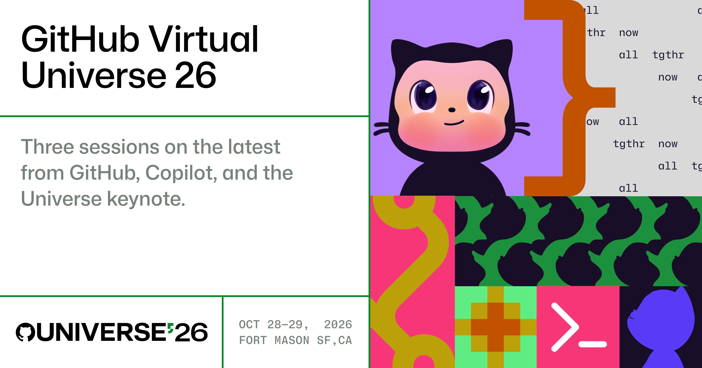

# GitHub Virtual Universe '26

Cookbooks to learn how to build with GitHub's latest features. 
Start by downloading the [**GitHub Copilot app**](https://github.com/features/ai/github-app) ✨ 

## What do you want to build?

- Section 1: [The Modern GitHub Experience](#section-1-the-modern-github-experience)
- Section 2: [Agentic Software Development with GitHub Copilot](#section-2-agentic-software-development-with-github-copilot)
- Section 3: [GitHub Universe Highlights](#section-3-github-universe-highlights)

## Section 1: The Modern GitHub Experience

### What's new on GitHub

Click the button below to open a pre-configured Codespace with all the dependencies needed for the cookbooks in this section. 

1. [Attach images to an issue](./01-github-latest-features/attach-images-to-an-issue/README.md): Add a screenshot to an issue from the terminal.
2. [Create a stacked PR](./01-github-latest-features/create-a-stacked-pr/README.md): Split one change into small pull requests that build on each other.

### Manage your open source project

Are you an open source maintainer? Check out the settings we've shipped to help you manage your projects and keep AI generated contributions under control. You can also join the community to connect with other maintainers and get direct support from our team.  

- [Set participation boundaries](https://docs.github.com/en/repositories/managing-your-repositorys-settings-and-features/enabling-features-for-your-repository/disabling-pull-requests): Define how people and agents can contribute to your project.
- [Manage your contribution queue](https://docs.github.com/en/communities/moderating-comments-and-conversations/archive-pull-requests): Organize incoming pull requests and keep reviews focused on actionable work.
- [Control contribution volume](https://github.blog/changelog/2026-06-17-limit-open-pull-requests-for-users-without-write-access/): Keep incoming PRs manageable for your team.

## Section 2: Agentic Software Development with GitHub Copilot

### Build your first Automation

Click the button below to open a guided GitHub Copilot App session to learn how to build your first Automation.

Learn about: 
1. [Skills](./02-github-copilot-latest-features/skills/README.md) 
2. [Tools and Connectors](./02-github-copilot-latest-features/tools-and-connectors/README.md) 
3. [Security Review](./02-github-copilot-latest-features/security-review/README.md) 
4. [Automations](./02-github-copilot-latest-features/automate/README.md)

## Section 3: GitHub Universe Highlights

### Putting it all together

1. [Attach a cheat sheet artifact](./github-virtual-universe-highlights/attach-a-cheat-sheet-artifact/): Attach an Artifact to an Issue and download a cheat sheet for everything in this repo. (Also find a ✨super duper secret surprise✨ at the end of this section)
2. [GitHub Universe recap page](https://github.com/events/universe/recap/): View all the main announcements, with links to demos and resources.

